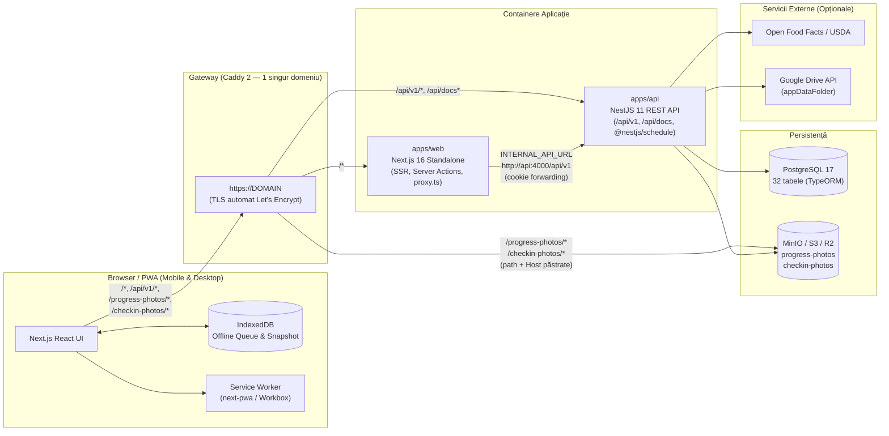
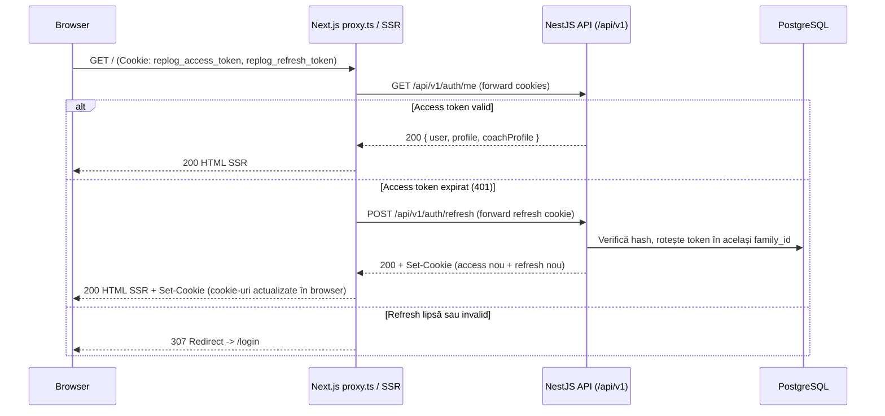
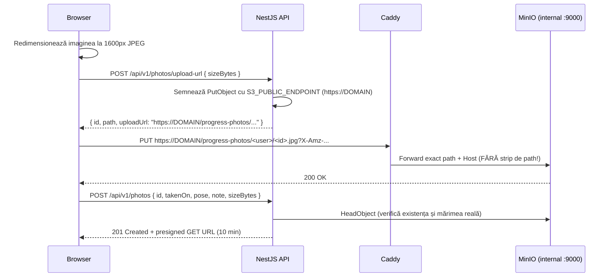

# Arhitectura Proiectului RepLog (`nova4`)

Acest document descrie arhitectura completă a aplicației **RepLog**: componentele sistemului, fluxurile critice de date, securitatea (Auth + Autorizare), structura bazei de date, stocarea imaginilor, modul offline și convențiile de UI.

---

## 1. Vedere de ansamblu (High-Level Architecture)

RepLog este o aplicație **PWA bilingvă (`ro` / `en`)** organizată ca **npm workspaces monorepo** pe **Node.js 24+**, fără dependențe externe de tip BaaS (zero Supabase).



### Principii arhitecturale fundamentale
1. **Separare strictă Frontend / Backend**: `apps/web` nu se conectează niciodată direct la PostgreSQL, nu deține chei S3/MinIO și nu rulează job-uri cron. Toate operațiile trec prin API-ul REST `apps/api`.
2. **Un singur domeniu public (Zero CORS în producție)**: Caddy servește UI-ul, API-ul (`/api/v1/*`) și fișierele presigned din MinIO (`/progress-photos/*`, `/checkin-photos/*`) sub același `https://DOMAIN`. Cookie-urile sunt same-origin, iar upload-ul/afișarea pozelor nu necesită preflight CORS.
3. **Logică pură partajată (`packages/shared`)**: formulele de domeniu (1RM, PR, plateau, TDEE adaptiv, analitice coach, validări offline, conversie `kg`/`lb`) sunt scrise o singură dată în TypeScript pur și importate atât de `apps/api`, cât și de `apps/web`.
4. **S3-compatible din design**: `StorageService` folosește `@aws-sdk/client-s3`. Local și pe VPS rulează MinIO, dar poți trece oricând pe Cloudflare R2 sau AWS S3 doar schimbând variabilele `S3_*`.

---

## 2. Structura Monorepo

```text
nova4/
├── packages/
│   └── shared/                 # @replog/shared — logică pură de domeniu, validări, tipuri, teste
│       └── src/
│           ├── coach/          # analytics, interactions, programs, meal-plans, meal-plan-pdf, types
│           ├── offline/        # model, errors, messages, rejected, types
│           └── *.ts / *.test.mjs
├── apps/
│   ├── api/                    # @replog/api — Backend NestJS 11 + TypeORM + Swagger
│   │   ├── Dockerfile          # Multi-stage node:24-alpine
│   │   ├── src/
│   │   │   ├── main.ts         # Bootstrap, PORT, SWAGGER_ENABLED
│   │   │   ├── app.setup.ts    # Global prefix /api/v1, helmet, cookie-parser, CORS, ValidationPipe, trust proxy
│   │   │   ├── app.module.ts   # Config, Schedule, Throttler, TypeORM, global Guards + 14 feature modules
│   │   │   ├── common/         # JwtAuthGuard, CoachGuard, ActiveCoachAccessGuard, @Public, @CurrentUser
│   │   │   ├── database/       # data-source.ts, 32 TypeORM entities, migrations/
│   │   │   ├── storage/        # StorageService (@aws-sdk/client-s3, auto-create buckets, presigned URLs)
│   │   │   └── modules/        # account, auth, coach, drive, foods, health, meal-plans, meals,
│   │   │                       # metrics, notifications, offline, photos, profiles, workouts
│   │   └── test/               # E2E integration tests (phase1, phase2, phase3)
│   └── web/                    # @replog/web — Frontend Next.js 16 + React 19 + Tailwind 4 + PWA
│       ├── proxy.ts            # Route guard + refresh automat token (înlocuiește middleware.ts în Next 16)
│       ├── next.config.ts      # output: "standalone", @ducanh2912/next-pwa, dev rewrite /api/v1/*
│       ├── app/                # App Router pages, Server Actions, components/ui/*
│       └── lib/
│           ├── api/            # client.ts (browser), server.ts (SSR/Actions), cookies.ts, types.ts
│           └── offline/        # IndexedDB store, OfflineProvider, sync engine
├── scripts/
│   ├── gen-secrets.mjs         # Generator de secrete criptografice pentru .env
│   ├── local-docker.mjs        # Runner cross-platform pentru stack-ul complet Docker local (+ Adminer)
│   └── migrate-from-supabase.ts # Script idempotent de migrare DB + Storage din Supabase
├── docker-compose.yml          # Stack producție (5 servicii + Adminer opțional pe profilul "tools")
├── docker-compose.dev.yml      # Servicii de bază pentru dev rapid (postgres + minio + adminer)
├── Dockerfile                  # Build standalone pentru apps/web (node:24-alpine)
├── Caddyfile                   # Routing single-domain
└── supabase/                   # [LEGACY / ARHIVAT] Referință istorică; NU se mai modifică
```

---

## 3. Autentificare, Sesiuni & Refresh Token

### Mecanică criptografică
- **Parole**: `PasswordService` (`apps/api/src/modules/auth/password.service.ts`) folosește `crypto.argon2` nativ din **Node.js 24+** (`argon2id`).
  - Pentru conturile migrate din Supabase (care au hash `$2a$` / `$2b$` bcrypt), `verify()` verifică prin `bcryptjs` și setează `needsRehash = true`, iar `AuthService.login()` face upgrade automat la Argon2id în Postgres la prima autentificare.
- **Access Token**: JWT semnat cu `JWT_ACCESS_SECRET` (TTL implicit `900s` = 15 min), payload `{ sub: userId, email, role }`. Livrat în cookie `HttpOnly; SameSite=Lax` (`replog_access_token`) + acceptat și ca `Authorization: Bearer <token>` (pentru viitoare aplicații mobile).
- **Refresh Token**: token opac random de 32 bytes (`base64url`), stocat **doar hash-uit SHA-256** în `public.refresh_tokens` (TTL implicit 30 zile), livrat în cookie `HttpOnly; SameSite=Lax` (`replog_refresh_token`).
  - **Rotation + Reuse Detection**: la fiecare `POST /api/v1/auth/refresh`, vechiul refresh token este marcat `revoked_at` și legat prin `replaced_by_id` de noul token din același `family_id`. Dacă un token deja revocat este refolosit (furt de cookie), **întreaga familie (`family_id`) este revocată imediat**.

### Fluxul de sesiune între Browser, Next.js și NestJS



### Rute publice vs. protejate
- **În NestJS (`apps/api`)**: `JwtAuthGuard` și `ThrottlerGuard` sunt înregistrate **global** în `AppModule`. Orice rută este protejată implicit; rutele publice se marchează explicit cu `@Public()` (ex: `/health`, `/auth/login`, `/auth/register`, `/auth/refresh`, `/auth/logout`, `/public/meal-plans/:token`, `/drive/cron`).
- **În Next.js (`apps/web/proxy.ts`)**: rutele publice fără redirect sunt `/offline`, `/privacy`, `/plan/[token]`, `/login`, `/register`, `/api/v1/*`, `/sw.js`, `/manifest.json` și scripturile workbox. Rutele `/coach/*` verifică în plus rolul `coach`.

---

## 4. Modelul de Autorizare (înlocuirea Postgres RLS)

Deoarece Postgres nu mai folosește RLS/PostgREST, autorizarea este implementată explicit în stratul NestJS și verificată prin teste E2E:

1. **Izolare per utilizator (`userId` scoping)**: fiecare query de citire/scriere din servicii folosește `user.userId` extras din JWT (`@CurrentUser()`), niciodată un `userId` trimis în body de client.
2. **`CoachGuard`** (`apps/api/src/common/guards/coach.guard.ts`): verifică în baza de date că utilizatorul are `profiles.role === 'coach'`.
3. **`ActiveCoachAccessGuard`** (`apps/api/src/common/guards/active-coach-access.guard.ts`): folosit pe rutele `/api/v1/coach/clients/:clientId/*` împreună cu decoratorul `@CoachAccess(...)`:
   - Verifică existența unui `enrollment` cu `status = 'active'` între `coach_id` și `client_id`.
   - Dacă ruta cere date de nutriție (`requireNutrition: true`), verifică în plus `share_nutrition = true`.
4. **Rute publice cu token**: `/api/v1/public/meal-plans/:token` returnează strict planul alimentar fără niciun PII (fără email-ul clientului sau date private); dacă `share_token` e revocat/inexistent, returnează `404`.

---

## 5. Modelul de Date (32 Tabele PostgreSQL)

Schema este gestionată exclusiv prin **TypeORM migrations** (`apps/api/src/database/migrations/`, `synchronize: false`, `migrationsRun: true` la pornirea API-ului).

| Domeniu | Tabele | Observații cheie |
| --- | --- | --- |
| **Identitate & Sesiuni** | `users`, `refresh_tokens`, `profiles`, `coach_profiles` | Toate tabelele de date au FK `ON DELETE CASCADE` spre `public.users(id)`. `users` are index unic case-insensitive pe `lower(email)`. |
| **Antrenamente** | `workouts`, `workout_sets`, `cardio_sessions`, `workout_drafts`, `workout_feedback` | Greutățile se stochează **mereu în `kg`**. `workouts` are index unic `(user_id, client_id)` pentru dedup offline. |
| **Nutriție** | `foods`, `meals`, `meal_items`, `meal_templates`, `user_targets` | `foods` cu `barcode` au `user_id = NULL` (catalog comun scris doar server-side din Open Food Facts). Alimentele manuale au `user_id` setat (private). |
| **Metrici Zilnice** | `daily_steps`, `daily_weight`, `daily_checkin` | Un rând per `(user_id, date)` — salvările ulterioare fac upsert. |
| **Poze Progres** | `progress_photos` | Trigger SQL `progress_photos_limit` impune maxim **200 poze/utilizator** (dublat în `PhotosService`). `path` respectă constrângerea `user_id/id.jpg`. |
| **Coaching & Programe** | `programs`, `program_workouts`, `program_workout_exercises`, `program_workout_cardio`, `enrollments`, `coach_client_notes`, `weekly_checkins`, `notifications` | `weekly_checkins` conține 3 sloturi opționale de poze (`photo_front_path`, `photo_back_path`, `photo_side_path`). |
| **Planuri Alimentare** | `meal_plans`, `meal_plan_days`, `meal_plan_meals`, `meal_plan_items` | `share_token` unic permite vizualizare publică read-only pe `/plan/[token]`. |
| **Offline & Backup** | `offline_sync_receipts`, `google_drive_backups` | `offline_sync_receipts` garantează idempotență per `(user_id, mutation_id)`. `google_drive_backups.refresh_token` este criptat AES-256-GCM cu `DRIVE_TOKEN_KEY`. |

---

## 6. Stocare Imagini (MinIO / S3 & AWS SigV4)

Imaginile NU intră în PostgreSQL; stau în 2 bucket-uri private create automat la pornirea `api` de `StorageService.onModuleInit()`:
- **`progress-photos`**: cheie `<user_id>/<photo_id>.jpg` (max 5 MB, redimensionat în browser la 1600px JPEG).
- **`checkin-photos`**: cheie `<client_id>/<photo_id>.jpg` (vizibil clientului și antrenorului activ).



### Invariant GDPR critic
Fișierele din S3/MinIO **nu se șterg prin `ON DELETE CASCADE` din SQL**. Prin urmare, `AccountService.deleteAllData()` și `AccountService.deleteAccount()` apelează `StorageService.deleteUserPrefix()` pe **ambele bucket-uri** (`progress-photos` și `checkin-photos`) **întâi** și anulează întreaga operație dacă ștergerea S3 eșuează, pentru a preveni obiecte orfane imposibil de șters ulterior.

---

## 7. Arhitectura Offline-First (PWA + IndexedDB)

- Când utilizatorul descarcă datele offline (`OfflineProvider` din `apps/web/lib/offline/client.tsx`), ultimele 90 de zile sunt salvate în IndexedDB **izolat pe `ownerId`** (la logout sau schimbare de cont, coada altui cont nu este niciodată afișată sau urcată).
- Mutațiile suportate offline: **antrenamente** (strength & cardio), **pași zilnici**, **greutate corporală**, **check-in zilnic**.
- Când există rețea, coada se retrimite ordonat către `POST /api/v1/offline/sync`:
  - `OfflineService` rulează într-o tranzacție PostgreSQL cu **advisory lock pe utilizator** (`pg_advisory_xact_lock`).
  - Verifică `offline_sync_receipts (user_id, mutation_id)` — dacă răspunsul s-a pierdut pe rețea și clientul retrimite aceeași mutație, serverul returnează rezultatul salvat fără a crea duplicate.
- Dacă utilizatorul navighează offline pe o pagină necached, Service Worker-ul redirecționează către `/offline` (fallback configurat în `apps/web/next.config.ts`).

---

## 8. Design System, Unități & Internaționalizare

- **Tailwind CSS 4** (`apps/web/app/globals.css`): paleta implicită Tailwind este dezactivată (`--color-*: initial`).
  - Singurul accent pentru acțiuni primare este `lime`.
  - Culorile de date (`coral`, `ice`, `lilac`, `gold`, `red`) se folosesc exclusiv pentru semantică (tipuri de seturi, macro-uri, serii grafice, avertismente).
  - Suprafețele sunt separate prin fill (`bg-background`, `bg-card`, `bg-inner`, `bg-control`), nu prin border-uri.
  - **Regula Tailwind 4**: nu suprascrie prin `className` o clasă de padding/fundal/înălțime deja setată în primitivele din `apps/web/app/components/ui/*` (în Tailwind 4 câștigă ordinea din CSS, nu din atribut) — adaugă un prop explicit (`compact`, `small`, `inCard`).
- **Bilingv (`ro` / `en`)**:
  - Server Components / Server Actions: `const { t, language, locale } = await getLanguage()` (`apps/web/app/language.ts`).
  - Client Components: `const { t } = useLanguage()` sau `<Text ro="..." en="..." />`.
  - Limba implicită este `en`, oglindită în cookie-ul `language`.
- **Unități de greutate**: stocare mereu în `kg`; conversia/formatarea trece prin `@replog/shared` (`units`), `useUnits()` (client) și `getWeightUnit()` / `getWeightFormatter()` (server, cookie `weight_unit`).
