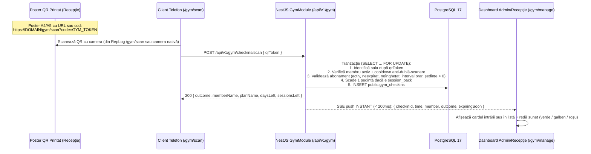
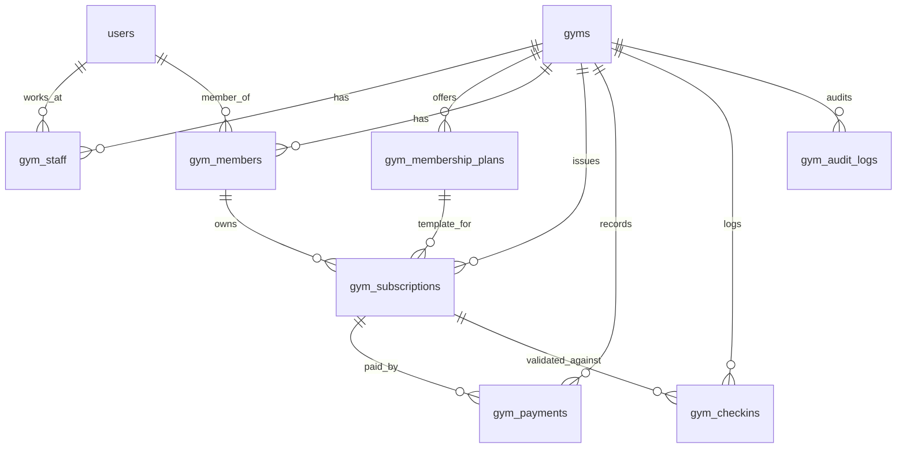

# Specificație & Arhitectură: Management Sală de Fitness + QR Check-in + Abonamente

Stare: **plan aprobat pentru implementare viitoare** (deciziile de produs au fost stabilite la 2026-11-26). Nimic din codul aplicației nu a fost modificat încă.

---

## 1. Obiectiv & Decizii de Produs Confirmate

Integrarea unui modul complet, 100% funcțional de **management al unei săli de fitness** direct în **RepLog**, respectând arhitectura monorepo (NestJS 11 + TypeORM + PostgreSQL 17 + Next.js 16 + Tailwind 4 design system) și folosind conturile existente ale utilizatorilor:

| Decizie | Varianta aleasă |
| --- | --- |
| **Mod scanare QR** | **QR printat la recepție** (generat direct din dashboard-ul sălii ca poster printabil A4/A5 cu buton *Print / Download*). Zero hardware suplimentar la intrare. |
| **Scanare client** | Direct din browser/PWA pe telefon (`/gym/scan`, folosind biblioteca `html5-qrcode` deja instalată în `apps/web`), pregătit cu același API REST pentru o viitoare aplicație mobilă nativă. |
| **Control acces la recepție** | **Recepție asistată**: Live Feed în timp real (Server-Sent Events) + **alertă sonoră** diferențiată (permis / avertizare expirare / respins) + Manual Check-in / Override cu motiv auditat. |
| **Tipuri de abonamente (MVP)** | Pe timp (`time_based`: Day Pass, 30 / 90 / 365 zile), pachet de ședințe (`session_pack`: 8 / 10 / 12 intrări), interval orar (`Day Time`, ex. `07:00–16:00` + zile ale săptămânii) și înghețare (`freeze` / `unfreeze` cu prelungire automată). |
| **Multi-tenant & roluri** | Schema suportă una sau mai multe săli (`gyms`), roluri per sală (`owner`, `manager`, `reception`), iar Super Admin-ul (`SUPER_ADMIN_EMAILS`) creează sălile și desemnează proprietarii. |

---

## 2. Fluxul End-to-End (QR Printat → Live Feed Recepție)

Nu este nevoie de Redis sau Socket.io: **NestJS suportă nativ Server-Sent Events (`@Sse()`)**, iar Caddy proxiază streaming HTTP nativ pe același domeniu.



### Bonus UX major pentru QR printat
Dacă QR-ul printat encodează URL-ul complet:
```text
https://<DOMAIN>/gym/scan?code=<gym.qr_token>
```
atunci funcționează în **ambele** moduri pentru client:
1. **Din aplicația RepLog** → apasă butonul „Check-in sală” (`/gym/scan`, cu `html5-qrcode`) și scanează posterul.
2. **Direct cu camera nativă a telefonului** → telefonul deschide link-ul în PWA/browser, unde user-ul deja logat confirmă intrarea cu 1 tap (sau automat la deschidere)!

### Protecții anti-fraudă potrivite pentru QR printat
1. **Vizibilitate live la recepție**: recepționerul aude bip-ul și vede instant numele + ora intrării — dacă cineva scanează de acasă o poză cu posterul, recepția observă imediat că nu a intrat nimeni pe ușă.
2. **Rotație rapidă a codului (`POST /api/v1/gym/:gymId/qr/rotate`)**: dacă posterul a fost fotografiat și distribuit, adminul generează un `qr_token` nou și printează noul poster în 10 secunde — cel vechi devine imediat invalid (`denied_invalid_qr`).
3. **Cooldown anti-dublă-scanare** (`checkin_cooldown_minutes`, implicit `15` min): dacă un client scanează din greșeală de 2 ori la rând, a doua scanare returnează `denied_duplicate` („Ești deja înregistrat la 14:52”) și **nu** îi scade o a doua ședință.
4. **Verificare opțională de proximitate GPS** (dezactivată implicit; configurabilă per sală cu `latitude`, `longitude`, `checkin_radius_meters` — ex. 150m — dacă o sală dorește blocarea scanărilor de la distanță).
5. **Blocare conturi dezactivate**: `JwtAuthGuard` respinge deja instant orice cont cu `users.disabled_at IS NOT NULL`.

---

## 3. Motorul de Validare a Abonamentelor

Logica pură trăiește în `packages/shared/src/gym/checkin-rules.ts` (testată unitar cu `node --test`) și rulează pe server în tranzacție PostgreSQL (`SELECT ... FOR UPDATE` pe abonament, eliminând orice race condition la scanări simultane).

### Ordinea deterministă de evaluare la check-in
1. **Validare sală & `qr_token`**: sala există, `is_active = true`, `qr_token` se potrivește → altfel `denied_invalid_qr`.
2. **Status membru**: există `gym_members` pentru `(gym_id, user_id)` cu `status = 'active'` → altfel `denied_not_member` sau `denied_suspended`.
3. **Cooldown**: există deja un check-in `allowed` al acestui user în sala respectivă în ultimele `checkin_cooldown_minutes` → `denied_duplicate` (fără a scădea ședințe).
4. **Selecție abonament eligibil** (dintre abonamentele membrului în această sală):
   - Nu există niciun abonament → `denied_no_subscription`.
   - Abonamentul curent e `frozen` → `denied_frozen` (afișează până când e înghețat).
   - Toate abonamentele au `ends_at < now()` → `denied_expired` (afișează data expirării).
   - Abonament `session_pack` cu `sessions_remaining <= 0` → `denied_no_sessions`.
   - Abonament cu restricție orară (`allowed_from_time` / `allowed_to_time` sau `allowed_days_mask`, evaluate în `gym.timezone`, ex. `Europe/Bucharest`) și ora curentă e în afara intervalului → `denied_outside_hours`.
5. **Acces permis (`allowed`)**:
   - Dacă `plan_type === 'session_pack'`, scade atomic `sessions_remaining = sessions_remaining - 1` (dacă ajunge la `0`, setează statusul `exhausted`).
   - Inserează rândul în `gym_checkins` cu `checked_in_at = now()`, `sessions_after`, `subscription_id`.
   - Emite eveniment SSE către recepție cu flag-ul `expiringSoon = (daysLeft <= 3 || sessionsLeft <= 2)`.

### Reguli de business pentru abonamente & încasări
- **Snapshot imutabil la achiziție**: `gym_subscriptions` salvează o copie a numelui planului (`plan_name_snapshot`), tipului, intervalului orar și ședințelor — modificarea ulterioară a prețului sau structurii planului din `gym_membership_plans` nu afectează abonamentele active.
- **Freeze (înghețare)**:
  - Adminul/managerul îngheață abonamentul (`frozen_at = now()`, `frozen_until = data aleasă`), verificând limita `max_freeze_days` a planului.
  - La dezghețare (manuală sau automată prin cron zilnic când `frozen_until <= now()`), `ends_at` se prelungește automat cu exact numărul de zile înghețate și se actualizează `total_frozen_days`.
- **Plăți la recepție**: fiecare activare/reînnoire poate înregistra plata asociată (`cash`, `card_pos`, `bank_transfer`, sumă stocată exact în subdiviziuni `amount_cents`, monedă `RON`/`EUR`, referință bon/notă, cine a încasat).
- **Notificări automate (`@nestjs/schedule` + `NotificationsModule`)**: cron zilnic la `09:00` marchează abonamentele expirate, dezgheață automat abonamentele cu `frozen_until` depășit și trimite notificare in-app membrilor ale căror abonamente expiră în 3 zile sau au rămas cu 1 ședință.

---

## 4. Modelul de Roluri & Permisiuni

| Acțiune | Super Admin (`SUPER_ADMIN_EMAILS`) | Gym `owner` | Gym `manager` | Gym `reception` | Membru (`client`/`coach`) |
| --- | :---: | :---: | :---: | :---: | :---: |
| Creează / dezactivează sală & desemnează `owner` | Da | — | — | — | — |
| Gestionează staff (`manager`, `reception`) | Da | Da | — | — | — |
| Setări sală, regenerare/printare QR, planuri & prețuri | Da | Da | Da | — | — |
| Export rapoarte financiare & audit log | Da | Da | Da | — | — |
| Live Check-in Desk (SSE + sunet) | Da | Da | Da | Da | — |
| Adăugare membri, activare/reînnoire abonament, încasări | Da | Da | Da | Da | — |
| Freeze / unfreeze abonament | Da | Da | Da | Opțional | — |
| Manual check-in / override (cu motiv obligatoriu) | Da | Da | Da | Da | — |
| Scanează QR intrare & vede propriul abonament/istoric | Da | Da | Da | Da | Da |

Autorizarea backend va folosi un guard dedicat `GymStaffGuard` + decorator `@GymRoles('owner', 'manager')` (similar cu `CoachGuard` și `SuperAdminGuard`), verificând apartenența strictă pe `(gym_id, user_id)` — un angajat al Sălii A primește `403 Forbidden` pe orice resursă a Sălii B.

---

## 5. Schema PostgreSQL Propusă (8 tabele noi)



### Detaliu tabele (migrație TypeORM nouă `AddGymManagement`)

1. **`public.gyms`**
   - `id uuid primary key default gen_random_uuid()`
   - `slug text not null unique`
   - `name text not null`
   - `address text`
   - `timezone text not null default 'Europe/Bucharest'`
   - `qr_token text not null unique` *(token random 32 bytes base64url, regenerabil oricând)*
   - `checkin_cooldown_minutes integer not null default 15 check (checkin_cooldown_minutes between 0 and 1440)`
   - `latitude numeric(9, 6)`, `longitude numeric(9, 6)`, `checkin_radius_meters integer` *(opțional GPS)*
   - `capacity integer`
   - `currency text not null default 'RON'`
   - `is_active boolean not null default true`
   - `created_at timestamptz not null default now()`, `updated_at timestamptz not null default now()`

2. **`public.gym_staff`**
   - `gym_id uuid not null references public.gyms(id) on delete cascade`
   - `user_id uuid not null references public.users(id) on delete cascade`
   - `role text not null check (role in ('owner', 'manager', 'reception'))`
   - `created_at timestamptz not null default now()`
   - `primary key (gym_id, user_id)`

3. **`public.gym_membership_plans`**
   - `id uuid primary key default gen_random_uuid()`
   - `gym_id uuid not null references public.gyms(id) on delete cascade`
   - `name text not null`
   - `description text`
   - `plan_type text not null check (plan_type in ('time_based', 'session_pack'))`
   - `duration_days integer not null check (duration_days between 1 and 3650)`
   - `session_count integer check (session_count is null or session_count between 1 and 1000)`
   - `price_cents integer not null check (price_cents >= 0)`
   - `currency text not null default 'RON'`
   - `allowed_from_time time`, `allowed_to_time time` *(ex: `07:00` – `16:00` pentru Day Time)*
   - `allowed_days_mask smallint not null default 127` *(bitmask 7 zile: Luni..Duminică)*
   - `max_freeze_days integer not null default 0 check (max_freeze_days between 0 and 365)`
   - `is_active boolean not null default true`
   - `position integer not null default 1`
   - `created_at timestamptz not null default now()`, `updated_at timestamptz not null default now()`

4. **`public.gym_members`**
   - `id uuid primary key default gen_random_uuid()`
   - `gym_id uuid not null references public.gyms(id) on delete cascade`
   - `user_id uuid not null references public.users(id) on delete cascade`
   - `member_code text not null` *(cod scurt prietenos, ex. `MEM-0042`, unic per sală)*
   - `phone text`
   - `emergency_contact text`
   - `notes text`
   - `status text not null default 'active' check (status in ('active', 'suspended'))`
   - `joined_at timestamptz not null default now()`
   - `unique (gym_id, user_id)`, `unique (gym_id, member_code)`

5. **`public.gym_subscriptions`**
   - `id uuid primary key default gen_random_uuid()`
   - `gym_id uuid not null references public.gyms(id) on delete cascade`
   - `member_id uuid not null references public.gym_members(id) on delete cascade`
   - `user_id uuid not null references public.users(id) on delete cascade`
   - `plan_id uuid references public.gym_membership_plans(id) on delete set null`
   - `plan_name_snapshot text not null`
   - `plan_type text not null check (plan_type in ('time_based', 'session_pack'))`
   - `status text not null check (status in ('pending', 'active', 'frozen', 'expired', 'exhausted', 'cancelled'))`
   - `starts_at timestamptz not null`, `ends_at timestamptz not null`
   - `sessions_total integer`, `sessions_remaining integer`
   - `allowed_from_time time`, `allowed_to_time time`, `allowed_days_mask smallint not null default 127`
   - `frozen_at timestamptz`, `frozen_until timestamptz`, `total_frozen_days integer not null default 0`
   - `created_by_user_id uuid references public.users(id) on delete set null`
   - `created_at timestamptz not null default now()`, `updated_at timestamptz not null default now()`

6. **`public.gym_payments`**
   - `id uuid primary key default gen_random_uuid()`
   - `gym_id uuid not null references public.gyms(id) on delete cascade`
   - `subscription_id uuid references public.gym_subscriptions(id) on delete set null`
   - `user_id uuid references public.users(id) on delete set null` *(GDPR + contabilitate: păstrează suma încasată chiar dacă fostul client își șterge contul)*
   - `amount_cents integer not null check (amount_cents >= 0)`
   - `currency text not null default 'RON'`
   - `method text not null check (method in ('cash', 'card_pos', 'bank_transfer', 'online'))`
   - `reference text`, `note text`
   - `recorded_by_user_id uuid references public.users(id) on delete set null`
   - `paid_at timestamptz not null default now()`

7. **`public.gym_checkins`**
   - `id uuid primary key default gen_random_uuid()`
   - `gym_id uuid not null references public.gyms(id) on delete cascade`
   - `user_id uuid not null references public.users(id) on delete cascade`
   - `subscription_id uuid references public.gym_subscriptions(id) on delete set null`
   - `checked_in_at timestamptz not null default now()`
   - `checked_out_at timestamptz`
   - `method text not null check (method in ('qr_printed', 'qr_kiosk', 'qr_member', 'manual_override'))`
   - `outcome text not null check (outcome in ('allowed', 'denied_invalid_qr', 'denied_not_member', 'denied_suspended', 'denied_duplicate', 'denied_no_subscription', 'denied_expired', 'denied_no_sessions', 'denied_frozen', 'denied_outside_hours'))`
   - `sessions_after integer`
   - `override_reason text`
   - `verified_by_user_id uuid references public.users(id) on delete set null`
   - `metadata jsonb not null default '{}'::jsonb`
   - Index: `(gym_id, checked_in_at desc)` și `(gym_id, user_id, checked_in_at desc)`.

8. **`public.gym_audit_logs`**
   - `id uuid primary key default gen_random_uuid()`
   - `gym_id uuid not null references public.gyms(id) on delete cascade`
   - `actor_user_id uuid references public.users(id) on delete set null`
   - `action text not null` *(ex: `subscription.created`, `subscription.frozen`, `checkin.manual_override`, `qr.rotated`)*
   - `target_type text`, `target_id uuid`
   - `details jsonb not null default '{}'::jsonb`
   - `created_at timestamptz not null default now()`

---

## 6. Contract API REST + SSE (`apps/api/src/modules/gym/`)

### Super Admin (`/api/v1/admin/gyms`)
- `GET /api/v1/admin/gyms` — listă săli + statistici membri/staff
- `POST /api/v1/admin/gyms` — creează sală nouă + desemnează `ownerUserId`
- `PATCH /api/v1/admin/gyms/:gymId` — actualizează sau dezactivează o sală

### Client / Membru (`/api/v1/gym`)
- `GET /api/v1/gym/my` — sălile în care utilizatorul este membru (cu abonament activ + ultimele intrări) și sălile unde este staff
- `POST /api/v1/gym/checkins/scan` — scanează `qrToken` (+ coordonate opționale), validează tranzacțional, emite SSE către recepție și întoarce rezultatul detaliat
- `GET /api/v1/gym/my/checkins` — istoricul propriu de intrări

### Admin Sală / Recepție (`/api/v1/gym/:gymId/...`, protejat de `GymStaffGuard`)
- **Live & Check-ins**:
  - `GET /api/v1/gym/:gymId/checkins/stream` — **SSE stream** (`text/event-stream`) pentru actualizare instantanee a recepției
  - `GET /api/v1/gym/:gymId/checkins?date=&outcome=&q=` — istoric intrări + statistici zi (total intrări, unici, respinși)
  - `POST /api/v1/gym/:gymId/checkins/manual` — manual check-in / override cu motiv obligatoriu (auditat)
- **QR Poster & Setări** (`owner`/`manager`):
  - `GET /api/v1/gym/:gymId/qr` — returnează `qrToken`, URL-ul complet de check-in și data ultimei rotații
  - `POST /api/v1/gym/:gymId/qr/rotate` — regenerează `qrToken` (invalidează imediat posterul vechi)
  - `PATCH /api/v1/gym/:gymId/settings` — nume, adresă, timezone, cooldown, capacitate, opțional GPS
- **Planuri de abonament** (`owner`/`manager`):
  - `GET / POST / PATCH /api/v1/gym/:gymId/plans`
- **Membri & Abonamente & Plăți** (`reception`+):
  - `GET / POST / PATCH /api/v1/gym/:gymId/members` *(poate înrola un user existent după email sau crea cont nou + membru direct de la recepție)*
  - `POST /api/v1/gym/:gymId/subscriptions` *(activează/reînnoiește abonament + înregistrează plata opțională în aceeași tranzacție)*
  - `POST /api/v1/gym/:gymId/subscriptions/:subId/freeze` / `unfreeze` / `cancel`
  - `GET /api/v1/gym/:gymId/payments?from=&to=&method=` *(încasări + totaluri pe metodă de plată)*
  - `GET /api/v1/gym/:gymId/audit` (`owner`/`manager`)

---

## 7. Experiența UI (100% Design System RepLog, Bilingv `RO`/`EN`)

Toate ecranele folosesc exclusiv primitivele din `apps/web/app/components/ui/*` (`Screen`, `Columns`, `Stack`, `Card`, `Inner`, `BigNumber`, `Button`, `IconButton`, `Input`, `Segmented`, `Badge`, `Message`, `Empty`) și tokenii din `apps/web/app/globals.css`:

1. **`/gym/scan` (Client — Scanner QR mobil)**
   - Deschide camera prin `html5-qrcode` (sau citește automat `?code=...` dacă s-a scanat cu camera nativă a telefonului).
   - La `allowed`: card mare verde (`lime`) cu confirmare, ora, zile/ședințe rămase și CTA primar **„Începe antrenamentul de azi”** → `/insert`.
   - La `denied_*`: card clar `red`/`coral` cu motivul exact (ex: *„Abonamentul a expirat pe 12 nov — vorbește la recepție pentru reînnoire”*).
2. **`/gym` (Client — Cardul meu de sală)**
   - Abonamentul curent (`Badge` `lime`/`gold`/`red`), zile/ședințe rămase, buton primar **Scanează QR Intrare**, istoric intrări recente și estimator opțional de aglomerație (*„~14 persoane în sală acum”*).
3. **`/gym/manage` (Admin Sală / Recepție)**
   - **Tab 1 — Live Intrări (default)**:
     - KPI-uri sus (`BigNumber`): Intrări azi, În sală acum (ultimele 90m), Abonamente active, Expiră în 3 zile.
     - Feed live conectat la SSE (cu indicator vizual *Live* `lime` și toggle *Sunet* pornit/oprit prin Web Audio API).
     - Fiecare intrare apare instant în capul listei: **Ora exactă**, **Nume & Email**, **Badge status** (`lime` Permis / `gold` Expiră curând / `red` Respins + motiv), **Plan & zile/ședințe rămase**, buton rapid **Reînnoiește abonament** chiar de pe cardul intrării respinse!
     - Buton **Check-in manual** pentru clienți fără baterie la telefon.
   - **Tab 2 — Membri & Abonamente**: căutare live, adăugare membru nou, activare/reînnoire abonament + metodă plată (`Cash` / `POS` / `Transfer`), acțiuni `Freeze` / `Unfreeze` / `Suspendă`.
   - **Tab 3 — Planuri & Tarife**: administrare planuri (`time_based` / `session_pack`, preț, durată, interval orar Day Time, zile max freeze).
   - **Tab 4 — QR Poster & Rapoarte**:
     - Previzualizare **Poster QR printabil** (A4/A5 cu logo RepLog, numele sălii și instrucțiuni RO/EN + buton `Print` folosind `@media print` deja configurat în `globals.css` + buton **Regenerează QR**).
     - Raport încasări pe perioadă/metodă plată + export CSV.
4. **Intrări în navigare (`/`)**:
   - Buton rapid **Check-in QR** pe dashboard pentru membrii unei săli;
   - Buton **Sală** (`tone="coral"` sau `ice`) în bara de sus pentru `gym_staff`.

---

## 8. Conformitate GDPR & Checklist Integrare RepLog

La implementare se vor respecta toate regulile din `docs/feature-development.md`:
- `AccountService.buildExport()`: include `gym_memberships`, `gym_subscriptions`, `gym_checkins` ale utilizatorului (fără `qr_token` și fără datele altor membri).
- `AccountService.deleteAccount()` / `deleteAllData()`: șterge datele personale prin `ON DELETE CASCADE`, păstrând `gym_payments.user_id = NULL` pentru integritatea registrului contabil al sălii.
- `EXPECTED_TABLES` în `apps/api/test/phase1.e2e-spec.ts` actualizat cu cele 8 tabele noi.

---

## 9. Roadmap de Implementare pe Faze

- **Faza 1 (MVP complet utilizabil într-o sală reală)**:
  - `packages/shared/src/gym/` (tipuri + reguli eligibilitate + unit tests).
  - Migrația TypeORM (8 tabele) + entități + `GymStaffGuard` + `GymModule` (toate endpoint-urile REST + SSE live stream).
  - UI `/gym/scan`, `/gym`, `/gym/manage` (Live Feed + sunet, Membri & Abonamente & Plăți, Planuri, Poster QR printabil).
  - Suita E2E `apps/api/test/gym.e2e-spec.ts` (izolare multi-sală, concurență `session_pack`, cooldown, freeze, interval orar, SSE, GDPR).
- **Faza 2 (Automatizări & Raportare)**:
  - Cron zilnic expirare/notificări + auto-unfreeze.
  - Export CSV încasări & prezențe + viewer Audit Log.
  - Opțional verificare proximitate GPS per sală.
- **Faza 3 (Extensii viitoare — doar dacă apare nevoia)**:
  - QR rotativ la 30s pe tabletă la intrare (kiosk mode) sau QR personal pe telefonul clientului pentru scanere USB.
  - Webhook turnichet / yală electromagnetică (`outcome = 'allowed'`).
  - Plăți online self-service (Stripe / Netopia) și corelare prezență în dashboard-ul de Coaching.
