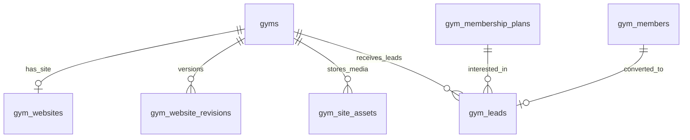

# Specificație & Arhitectură: Website de Prezentare Sală + Drag & Drop Website Builder

Stare: **propunere de plan pentru implementare viitoare** (2026-11-26). Nimic din codul aplicației nu a fost modificat încă.

---

## 1. Obiectiv & Viziune de Produs

Deoarece RepLog include deja modulul de **Management Sală (`gyms`, `gym_membership_plans`, `gym_staff`, `gym_members`, `gym_checkins`)**, următorul pas firesc este ca fiecare sală să aibă propriul **website public de prezentare**, complet personalizabil printr-un **editor vizual Drag & Drop** direct din dashboard-ul sălii (`/gym/manage`).

### De ce integrat în RepLog (avantaj față de un site extern WordPress/Wix)
1. **O singură sursă de adevăr (date live)**:
   - Blocul **Planuri & Tarife** citește automat planurile active din `gym_membership_plans` — patronul schimbă prețul o singură dată și site-ul se actualizează instant.
   - Blocul **Aglomerație Live** (opțional) poate afișa gradul curent de ocupare din `gym_checkins` + `gyms.capacity` (fără a expune date personale).
   - Blocul **Echipă / Antrenori** se poate sincroniza opțional cu profilurile publice din `coach_profiles` / `gym_staff`.
2. **Conversie directă în membri (Lead → Membru cu 1 click)**:
   - Formularul de pe site (*„Rezervă o zi de probă” / „Cere informații”*) ajunge direct în inbox-ul din `/gym/manage`, unde recepția îl poate transforma în membru (`gym_members`) fără să copieze datele manual.
3. **Zero mentenanță & zero cost suplimentar de hosting**:
   - Rulează pe același stack (Next.js 16 + NestJS 11 + PostgreSQL 17 + MinIO + Caddy), cu SSL automat și SEO (SSR + OpenGraph + JSON-LD pentru Google).

### URL public & Routing
- Fiecare sală are deja câmpul unic `gyms.slug`.
- Ruta publică recomandată: **`https://<DOMAIN>/s/<slug>`** (ex: `https://replog.ro/s/iron-house`).
  - Scurtă, neutră lingvistic (`RO`/`EN`), nu intră în coliziune cu rutele existente `/gym`, `/gym/scan`, `/gym/manage`.
  - În **Faza 3**, aceeași infrastructură poate susține **domeniu propriu** per sală (ex: `https://ironhouse.ro`) prin `custom_domain` + Caddy On-Demand TLS + rutare după header-ul `Host` în `apps/web/proxy.ts`.

---

## 2. Arhitectura Builder-ului: Block-Based Drag & Drop

### De ce Block-Based (secțiuni structurate) și nu Freeform Canvas `(x, y)`
| Criteriu | Block-Based Drag & Drop *(recomandat)* | Freeform Canvas (`position: absolute`) |
| --- | --- | --- |
| **Responsive pe mobil** | Automat, curat pe orice ecran fără muncă dublă | Patronul strică ușor versiunea de mobil |
| **Calitate vizuală** | Arată profesionist din start (spacing & grid controlat) | Risc mare de suprapuneri și aspect neîngrijit |
| **Securitate (XSS)** | JSON structurat + validare strictă, zero HTML/JS liber | Necesită sanitizare complexă |
| **Date live RepLog** | Blocuri native (`live_pricing`, `live_occupancy`, `lead_form`) | Greu de sincronizat |
| **Viteză de creare** | 5–10 minute pornind de la un template | Ore întregi de aranjat pixeli |

### Tehnologie Drag & Drop
- **Librărie recomandată**: `@dnd-kit/core` + `@dnd-kit/sortable` + `@dnd-kit/utilities` (compatibilă React 19, ușoară, suportă mouse, touch și tastatură/accesibilitate).
- **Două niveluri de Drag & Drop**:
  1. **La nivel de pagină**: tragi blocuri noi din paleta din stânga direct în locul dorit din pagină și reordonezi secțiunile existente pe verticală.
  2. **În interiorul unui bloc**: reordonezi cardurile de facilități, pozele din galerie, antrenorii, întrebările FAQ, recenziile și linkurile din meniul de navigare.
- **WYSIWYG real (1:1)**: canvas-ul editorului folosește **exact aceleași componente React** ca pagina publică `/s/[slug]` (`GymSiteRenderer`), astfel încât patronul vede exact ce vor vedea vizitatorii.

---

## 3. Catalogul de Blocuri (Section Blocks)

Toate blocurile sunt definite într-o schemă versiunea 1 (`schemaVersion: 1`) în `packages/shared/src/gym-website/`. Fiecare bloc are `id` (UUID), `type`, `visible` (boolean), `anchor` (opțional, ex. `tarife` pentru scroll din meniu), `style` (variantă de fundal: `default` / `surface` / `accent_soft`, padding `compact` / `normal` / `spacious`) și `data` (cu texte simple sau bilingve `{ ro, en }`).

### Blocuri MVP (Faza 1)
1. **`hero`** — Secțiunea principală de impact:
   - Variante layout: `full_bleed` (poză fundal + overlay), `split_right` (text stânga, poză dreapta), `split_left`, `centered`.
   - Elemente: badge opțional (*„Deschis 24/7”*), titlu principal, subtitlu, 1–2 butoane CTA (ancoră `#tarife`, link WhatsApp, telefon, `/register`, URL extern).
2. **`stats_bar`** — Bandă de 3–4 cifre-cheie (ex. `1.200 mp`, `90+ aparate`, `4.9 ★ Google`, `Parcare gratuită`).
3. **`live_pricing`** — **Tarife & Abonamente (sincronizat live cu `gym_membership_plans`)**:
   - Patronul alege modul: *„Toate planurile active”* sau *„Selecție manuală + ordine custom”*.
   - Opțiuni per plan: badge *„Cel mai popular”*, descriere extinsă opțională, text buton CTA (ex. *„Alege abonamentul”* → scroll la formularul de contact cu planul preselectat, sau link WhatsApp pre-completat).
   - Afișează automat tipul (`time_based` / `session_pack`), durata, intervalul orar (`Day Time`) și prețul formatat în moneda sălii.
4. **`features_grid`** — Facilități & zone ale sălii (Forță, Cardio, Funcțional, Saună, Dușuri, Parcare, Wi-Fi, Bar proteic):
   - Iconiță din selecție curată Lucide, titlu, descriere scurtă, grid configurabil `2` / `3` / `4` coloane.
5. **`gallery`** — Galerie foto a sălii:
   - Layout `grid`, `bento` (o poză mare + miniaturi) sau `carousel`.
   - Lightbox la click, caption opțional per poză, ordine drag-and-drop.
6. **`schedule_hours`** — Program de funcționare:
   - Ore Luni–Duminică (sau grupe *Luni–Vineri*, *Sâmbătă*, *Duminică*) + badge live **„Deschis acum” / „Închis”** calculat în `gym.timezone` (`Europe/Bucharest`).
   - Opțional: mini-tabel cu clase de grup (zi, oră, clasă, antrenor).
7. **`location_contact`** — Locație, hartă & date de contact:
   - Adresă (preluată default din `gyms.address`), telefon (click-to-call), WhatsApp, email, linkuri Instagram / Facebook / TikTok.
   - Butoane rapide **„Deschide în Google Maps”** și **„Waze”** + embed hartă generat sigur din `gyms.latitude` / `gyms.longitude` (fără iframe arbitrar de la user).
8. **`cta_banner`** — Bandă promoțională de conversie (ex. *„Prima intrare gratuită luna aceasta”* + buton CTA).

### Blocuri Extinse (Faza 2)
9. **`lead_form`** — Formular **„Rezervă zi de probă / Cere informații”** (nume, telefon, email opțional, plan de interes, mesaj, acord GDPR, protecție anti-spam).
10. **`trainers`** — Echipa de antrenori personali (poză, nume, rol/specializare, scurtă descriere, Instagram sau link profil Coach RepLog).
11. **`testimonials`** — Recenzii ale membrilor (nume, rating 1–5 stele, citat, layout grid sau carousel).
12. **`faq`** — Întrebări frecvente în format accordion (ex. regulament, înghețare abonament, echipament necesar).
13. **`live_occupancy`** — Indicator live de aglomerație (*„Liber” / „Moderat” / „Aglomerat”* sau `~14 / 60 persoane`, calculat din check-in-urile din ultimele 90 min vs `gyms.capacity`, doar dacă patronul activează blocul).
14. **`about_text`** — Secțiune „Despre noi” (text structurat + imagine stânga/dreapta + listă de puncte cheie).

### Elemente globale de site (Header & Footer)
Configurate separat în tab-ul **Navigare & Brand** (nu ca blocuri duplicabile):
- **Header**: logo imagine sau text, meniu cu linkuri către ancorele secțiunilor (`#tarife`, `#galerie`, `#program`, `#contact`), buton CTA principal (ex. *„Programează vizită”*), selector `RO`/`EN` (dacă bilingvismul e activat).
- **Footer**: logo, scurtă descriere, program rezumat, linkuri social media, link Politică de confidențialitate & badge discret *„Powered by RepLog”* (cu link către `/login` pentru membrii existenți).

---

## 4. Tematizare, Branding & Izolare Vizuală

Patronul își poate personaliza identitatea vizuală fără să scrie CSS și fără să afecteze aplicația internă RepLog:

- **Preset-uri de temă gata făcute** (1 click):
  - *RepLog Dark Lime* (default, contrast puternic `#09090b` + `#c8f031`)
  - *Obsidian Gold* (negru + auriu, stil premium)
  - *Iron Red* (antracit + roșu energic, stil bodybuilding/powerlifting)
  - *Electric Ice* (bleumarin închis + albastru rece, stil funcțional/CrossFit)
  - *Studio Light* (alb cald `#f5f4ef` + negru + accent ales, stil pilates/boutique)
- **Personalizare controlată**:
  - `mode`: `dark` / `light`
  - `accentHex`: picker cu validare strictă `#RRGGBB` + calcul automat al culorii textului pe buton (`#0c0c0d` sau `#ffffff`) pe baza luminanței WCAG.
  - `radius`: `sharp` (`8px`) / `rounded` (`16px`) / `pill` (`24px`).
  - `fontPair`: 3–4 perechi curate (ex. `Geist`, `Space Grotesk + Inter`, `Outfit + Inter`).
- **Izolare față de `apps/web/app/globals.css`**:
  - Toate stilurile site-ului public citesc variabile CSS scoped pe containerul `.gym-site-root` (`--site-bg`, `--site-surface`, `--site-fg`, `--site-muted`, `--site-accent`, `--site-on-accent`, `--site-radius`).
  - Aplicația RepLog rămâne 100% izolată de tema aleasă de o sală; iar în editor, canvas-ul aplică `.gym-site-root` doar pe zona de preview!
- **Separare Layout în Next.js 16 (Route Groups)**:
  - În prezent, `apps/web/app/layout.tsx` randează bara globală (`NotificationBell`, `LanguageSelector`, `ThemeToggle`, `OfflineStatus`, `DriveAutoSync`) și face apel `getSessionUser()`.
  - Pentru ca `/s/[slug]` să arate ca un site de sine stătător (fără bara RepLog, fără apel de sesiune, cu performanță maximă SEO), reorganizăm curat App Router cu două Route Groups:
    - `apps/web/app/(app)/layout.tsx` — toate rutele aplicației RepLog (neschimbate ca URL!).
    - `apps/web/app/(site)/s/[slug]/layout.tsx` — layout minimal dedicat site-urilor publice de sală.

---

## 5. Experiența Editorului Drag & Drop (`/gym/manage/website`)

### Punct de intrare în `/gym/manage`
În `apps/web/app/gym/manage/gym-manage-client.tsx` adăugăm tab-ul **„Website”** (al 5-lea tab, lângă *Live*, *Membri*, *Planuri*, *QR Poster*):
- Card status: **Publicat / Draft**, link public `https://<DOMAIN>/s/<slug>` cu butoane *Copiază*, *Deschide*, *QR Website* (printabil pentru flyere/ușă).
- Buton primar `lime`: **„Deschide Website Builder”** → navighează la `/gym/manage/website?gymId=<id>`.
- **Inbox Lead-uri** (Faza 2): lista cererilor primite din formularul site-ului, cu filtru `Nou` / `Contactat` / `Convertit`, buton telefon/WhatsApp și buton **„Creează membru”** (deschide modalul existent de membru pre-completat!).

### Layout-ul cu 3 Panouri al Website Builder-ului
```text
┌──────────────────────────────────────────────────────────────────────────────┐
│ ← Înapoi  | Iron House · [Draft / Publicat] | [Desktop|Tab|Mob] | ↶ ↷ | [Template] [Preview] [Publică] │
├──────────────────┬───────────────────────────────────────┬───────────────────┤
│ [Blocuri|Straturi│                                       │ Inspector Bloc    │
│  |Temă & SEO]    │          CANVAS LIVE (1:1)            │                   │
│                  │   ┌───────────────────────────────┐   │ Tip: Hero         │
│ + Hero           │   │ [≡] Hero   [↑][↓][👁][⧉][🗑]  │   │ Layout: [Split ▾] │
│ + Cifre cheie    │   │   ANTREANĂ-TE FĂRĂ SCUZE      │   │                   │
│ + Tarife Live ★  │   │   [Vezi tarife] [Zi de probă] │   │ Titlu (RO)        │
│ + Facilități     │   └───────────────────────────────┘   │ [_______________] │
│ + Galerie Foto   │              + Adaugă aici            │ Subtitlu (RO)     │
│ + Program        │   ┌───────────────────────────────┐   │ [_______________] │
│ + Aglomerație ★  │   │ [≡] Tarife Live (auto-sync)   │   │ Imagine fundal    │
│ + Echipă         │   │   [Lunar] [DayTime] [10 sed]  │   │ [Alege din Media] │
│ + Recenzii       │   └───────────────────────────────┘   │                   │
│ + FAQ            │                                       │ CTA Principal     │
│ + Hartă & Contact│                                       │ Text + Destinație │
│ + Formular Probă │                                       │                   │
└──────────────────┴───────────────────────────────────────┴───────────────────┘
```

### Funcționalități UX cheie în Editor
1. **Starter Templates (Onboarding în 30 secunde)**: la prima deschidere a builder-ului, patronul alege unul dintre 3–4 șabloane pre-populate cu numele, adresa și planurile reale ale sălii sale (*Modern Dark*, *Boutique Light*, *Performance / Functional*, *Pagină Goală*).
2. **Draft vs Published + Auto-save**:
   - Orice modificare se salvează automat în `draft_blocks` (debounce `1.5s`, cu indicator *„Salvat”* / *„Se salvează...”*).
   - Site-ul public nu se modifică până când patronul apasă **Publică**!
3. **Preview privat (`?preview=<preview_token>`)**: patronul poate deschide sau trimite unui coleg linkul de preview al draft-ului înainte de publicare.
4. **Undo / Redo**: stivă de ~50 de stări în client (`Ctrl+Z` / `Ctrl+Shift+Z`).
5. **Istoric Revizii & Rollback (Faza 2)**: fiecare click pe **Publică** păstrează un snapshot în `gym_website_revisions` (ultimele 20) cu restaurare cu 1 click.
6. **Media Library integrată**: upload imagini cu drag-and-drop, redimensionare automată în browser (`canvas` → WebP/JPEG max `1920px`), previzualizare miniaturi, text `alt` pentru SEO și ștergere.
7. **Suport pe mobil/tabletă**: pe ecrane înguste, panourile devin drawer-e, iar reordonarea funcționează și prin butoane sus/jos (`↑` / `↓`), nu doar drag.

---

## 6. Stocare Imagini Publice (MinIO / S3 & Caddy)

### Diferența față de `progress-photos` / `checkin-photos`
Bucket-urile actuale din `StorageService` (`progress-photos`, `checkin-photos`) sunt **private și criptate** (`PHOTO_ENCRYPTION_KEY`) cu linkuri presigned de 10 minute. Pentru un website public de prezentare avem nevoie de:
- URL-uri stabile, publice și cache-able (`Cache-Control: public, max-age=31536000, immutable`) pentru viteză maximă și pentru imaginile OpenGraph (`og:image` pe WhatsApp / Facebook).
- **Fără criptare** (imaginile de prezentare ale sălii sunt publice prin definiție).

### Soluția propusă
- Bucket nou în MinIO/S3: **`gym-site-assets`** (configurabil prin `S3_BUCKET_GYM_SITE_ASSETS`, auto-creat în `StorageService.onModuleInit()`, exclus din `isPhotoBucket()`).
- Cheie de stocare: `<gymId>/<assetId>.<ext>` (`webp` / `jpg` / `png` — **fără SVG** pentru a preveni XSS prin fișiere SVG!).
- **Upload**: browserul redimensionează imaginea → `POST /api/v1/gym/:gymId/website/assets` (`multipart/form-data`, max `5 MB`, validare magic bytes, limită implicită `50` imagini / `100 MB` per sală) → API urcă în MinIO și salvează metadatele în `gym_site_assets`.
- **Servire (două opțiuni curate)**:
  - **Varianta A (recomandată pentru Faza 1 — zero config extra în MinIO/Caddy)**: endpoint public NestJS `GET /api/v1/public/gyms/assets/:gymId/:assetId` care face stream din MinIO cu `Cache-Control: public, max-age=31536000, immutable` și `ETag`. Funcționează identic în dev local și în Docker Compose fără politici speciale pe bucket.
  - **Varianta B (optimizare trafic mare)**: bucket policy `read-only` în MinIO + rută `handle /gym-site-assets/* { reverse_proxy minio:9000 }` în `Caddyfile` (zero încărcare pe NestJS).

---

## 7. Modelul de Roluri & Permisiuni

Folosește infrastructura existentă `GymStaffGuard` + `@GymRoles(...)`:

| Acțiune | Super Admin | Gym `owner` | Gym `manager` | Gym `reception` | Public (vizitator) |
| --- | :---: | :---: | :---: | :---: | :---: |
| Vizualizează site-ul public `/s/[slug]` | Da | Da | Da | Da | Da |
| Trimite formular probă / contact (`lead_form`) | Da | Da | Da | Da | Da |
| Editează draft, teme, Media Library | Da | Da | Da | — | — |
| Publică / Ascunde site-ul & Rollback revizii | Da | Da | Da | — | — |
| Vezi & gestionează Lead-uri, convertește în membru | Da | Da | Da | Da | — |
| Configurează domeniu propriu (Faza 3) | Da | Da | — | — | — |

---

## 8. Schema PostgreSQL Propusă (4 tabele noi)



### Detaliu tabele (migrație TypeORM nouă `AddGymWebsiteBuilder`)

1. **`public.gym_websites`** *(1-la-1 cu `public.gyms`)*
   - `gym_id uuid primary key references public.gyms(id) on delete cascade`
   - `is_published boolean not null default false`
   - `schema_version integer not null default 1`
   - `default_language text not null default 'ro' check (default_language in ('ro', 'en'))`
   - `bilingual_enabled boolean not null default false`
   - `draft_theme jsonb not null default '{}'::jsonb`
   - `draft_seo jsonb not null default '{}'::jsonb`
   - `draft_navigation jsonb not null default '{}'::jsonb`
   - `draft_blocks jsonb not null default '[]'::jsonb`
   - `published_theme jsonb`
   - `published_seo jsonb`
   - `published_navigation jsonb`
   - `published_blocks jsonb`
   - `preview_token text not null unique` *(random 24 bytes base64url, regenerabil)*
   - `custom_domain text unique` *(nullable, pregătit pentru Faza 3)*
   - `published_at timestamptz`
   - `updated_by_user_id uuid references public.users(id) on delete set null`
   - `created_at timestamptz not null default now()`, `updated_at timestamptz not null default now()`

2. **`public.gym_website_revisions`** *(istoric versiuni publicate pentru rollback)*
   - `id uuid primary key default gen_random_uuid()`
   - `gym_id uuid not null references public.gyms(id) on delete cascade`
   - `version_number integer not null`
   - `snapshot jsonb not null` *(`{ schemaVersion, theme, seo, navigation, blocks }`)*
   - `published_by_user_id uuid references public.users(id) on delete set null`
   - `created_at timestamptz not null default now()`
   - `unique (gym_id, version_number)`

3. **`public.gym_site_assets`** *(biblioteca media a sălii)*
   - `id uuid primary key default gen_random_uuid()`
   - `gym_id uuid not null references public.gyms(id) on delete cascade`
   - `storage_key text not null unique`
   - `mime_type text not null check (mime_type in ('image/jpeg', 'image/png', 'image/webp'))`
   - `size_bytes integer not null check (size_bytes > 0 and size_bytes <= 5242880)`
   - `width integer`, `height integer`
   - `alt_ro text`, `alt_en text`
   - `uploaded_by_user_id uuid references public.users(id) on delete set null`
   - `created_at timestamptz not null default now()`
   - Index: `(gym_id, created_at desc)`.

4. **`public.gym_leads`** *(cereri din formularul site-ului)*
   - `id uuid primary key default gen_random_uuid()`
   - `gym_id uuid not null references public.gyms(id) on delete cascade`
   - `name text not null`
   - `phone text`, `email text` *(cel puțin unul obligatoriu la validare)*
   - `interested_plan_id uuid references public.gym_membership_plans(id) on delete set null`
   - `message text`
   - `status text not null default 'new' check (status in ('new', 'contacted', 'converted', 'archived'))`
   - `converted_member_id uuid references public.gym_members(id) on delete set null`
   - `consent_accepted_at timestamptz not null default now()`
   - `source_ip_hash text` *(hash zilnic cu salt rotativ pentru anti-spam, fără IP brut)*
   - `created_at timestamptz not null default now()`, `updated_at timestamptz not null default now()`
   - Index: `(gym_id, status, created_at desc)`.

*(Opțional în Faza 2)* **`public.gym_site_daily_stats`**:
- `gym_id uuid not null references public.gyms(id) on delete cascade`
- `day date not null`
- `page_views integer not null default 0`
- `cta_clicks integer not null default 0`
- `leads_count integer not null default 0`
- `primary key (gym_id, day)` — analytics 100% cookie-free, fără trackere externe.

---

## 9. Contract API REST (`apps/api/src/modules/gym-website/`)

### Endpoint-uri Publice (`@Public()`, fără auth)
- `GET /api/v1/public/gyms/:slug?preview=<token>`
  - Returnează payload-ul complet pentru SSR: `gym` (doar câmpuri publice: `id`, `slug`, `name`, `address`, `timezone`, `latitude`, `longitude`, `currency`), `website` (`theme`, `seo`, `navigation`, `blocks`, `defaultLanguage`, `bilingualEnabled`), `plans` (doar planurile active `gym_membership_plans`), `occupancy` (doar dacă un bloc `live_occupancy` activ este prezent și `capacity` e setat) și `assets` (harta `assetId -> publicUrl`).
  - **Nu expune niciodată** `qr_token`, staff, membri, plăți sau date interne.
  - Dacă site-ul nu e publicat și nu există `preview` valid → `404 Not Found`.
- `GET /api/v1/public/gyms/assets/:gymId/:assetId`
  - Servește imaginea din MinIO (`gym-site-assets`) cu `Cache-Control: public, max-age=31536000, immutable` și `Content-Type` strict din DB.
- `POST /api/v1/public/gyms/:slug/leads` *(rate-limit strict, ex. `5 / 15 min` per IP + câmp honeypot ascuns)*
  - Validează inputul, salvează în `gym_leads` și trimite notificare in-app către staff-ul sălii (`NotificationsModule`).
- `GET /api/v1/public/gyms/sitemap`
  - Returnează lista `{ slug, updatedAt }` a sălilor cu `is_published = true` (folosit de `apps/web/app/sitemap.ts`).

### Endpoint-uri Admin Sală (`/api/v1/gym/:gymId/...`, protejate de `GymStaffGuard`)
- `GET /api/v1/gym/:gymId/website` (`owner`, `manager`) — draft + status publicare + `previewToken` + listă planuri & asset-uri.
- `PUT /api/v1/gym/:gymId/website/draft` (`owner`, `manager`) — salvează draft-ul (validat strict împotriva validatorului din `@replog/shared`).
- `POST /api/v1/gym/:gymId/website/apply-template` (`owner`, `manager`) — generează draft dintr-un template predefinit (`modern_dark`, `boutique_light`, `functional_pro`, `blank`).
- `POST /api/v1/gym/:gymId/website/publish` (`owner`, `manager`) — validează draft-ul, publică atomic (`draft_* -> published_*`), creează revizie în `gym_website_revisions` (păstrând ultimele 20) și înregistrează în `gym_audit_logs`.
- `POST /api/v1/gym/:gymId/website/unpublish` (`owner`, `manager`) — retrage site-ul din public (`is_published = false`).
- `GET /api/v1/gym/:gymId/website/revisions` & `POST /api/v1/gym/:gymId/website/revisions/:revisionId/restore` (`owner`, `manager`).
- `GET / POST / DELETE /api/v1/gym/:gymId/website/assets` (`owner`, `manager`) — Media Library (upload + ștergere sincronă din MinIO și DB).
- `GET / PATCH / DELETE /api/v1/gym/:gymId/leads` (`owner`, `manager`, `reception`) — inbox lead-uri, actualizare status, ștergere GDPR.
- `POST /api/v1/gym/:gymId/leads/:leadId/convert` (`owner`, `manager`, `reception`) — înrolează lead-ul ca membru (`gym_members`) și îl marchează `converted`.

---

## 10. Securitate, SEO & Conformitate GDPR

### Securitate & Sanitizare
- **Zero XSS**: blocurile conțin exclusiv date structurate randate prin componente React standard — niciodată `dangerouslySetInnerHTML`, `<script>`, CSS arbitrar sau `<iframe>` liber introdus de utilizator.
- **Whitelist URL-uri**: toate linkurile din butoane CTA / meniu / social media sunt validate prin helper-ul pur `sanitizeWebsiteUrl()` (`https://`, `http://`, `mailto:`, `tel:`, `#anchor`, sau rute interne permise `/register`, `/login`, `/gym`). Orice `javascript:` / `data:` este respins la salvare **și** ignorat la randare.
- **Limites & anti-abuz**:
  - Max `30` blocuri per site, max `256 KB` payload JSON per draft.
  - Max `50` imagini / `100 MB` per sală, fără fișiere SVG.
  - Anti-spam pe `POST /leads`: `@Throttle` strict + honeypot invizibil + verificare lungime câmpuri.
- **Izolare multi-tenant**: fiecare endpoint verifică `(gymId, userId)` în `GymStaffGuard` și verifică faptul că `assetId` / `revisionId` / `leadId` aparține de `gymId`.

### SEO & Performanță
- **SSR dinamic** pe `/s/[slug]` (`generateMetadata`): `title`, `description`, `openGraph` (`og:image` din `seo.ogAssetId` sau poza din `hero`), `twitter:card = summary_large_image`.
- **JSON-LD (`HealthClub` / `ExerciseGym`)** injectat sigur din date structurate: nume sală, adresă, coordonate GPS, telefon, program de funcționare și oferte de preț din `gym_membership_plans` → afișare bogată în Google Search.
- Paginile cu `?preview=...` primesc automat `robots: { index: false, follow: false }`.
- `apps/web/proxy.ts` lasă public `path.startsWith("/s/")` fără redirect la `/login`.

### Checklist GDPR & Integrare RepLog
- `gym_leads` cere acord explicit la trimitere (`consent_accepted_at`), are buton de ștergere permanentă pentru staff și un cron zilnic poate curăța automat lead-urile arhivate mai vechi de 12 luni.
- La dezactivarea/ștergerea unei săli se curăță prefixul `<gymId>/` din bucket-ul MinIO `gym-site-assets`.
- `EXPECTED_TABLES` din `apps/api/test/phase1.e2e-spec.ts` actualizat cu cele 4 tabele noi.
- Validarea structurii blocurilor stă în `@replog/shared`, testată unitar cu `node --test`, și este folosită identic atât în NestJS DTO/Service, cât și în editorul web.

---

## 11. Structura Fișierelor (Monorepo)

```text
packages/shared/src/gym-website/
  types.ts                 # Tipuri blocuri, temă, SEO, navigare, public payload
  validation.ts            # Validare schemă, sanitizare URL/culoare, limite
  templates.ts             # 4 starter templates (Modern Dark, Boutique Light, Functional, Blank)
  gym-website.test.mjs     # Unit tests (validare, XSS/URL, templates, contrast WCAG)

apps/api/src/
  database/entities/gym-website.entity.ts
  database/migrations/<timestamp>-AddGymWebsiteBuilder.ts
  storage/storage.service.ts             # + bucket `gym-site-assets` (necriptat)
  modules/gym-website/
    gym-website.module.ts
    gym-website.service.ts
    gym-website.controller.ts            # /api/v1/gym/:gymId/website/* & /leads/*
    public-gym-website.controller.ts     # /api/v1/public/gyms/*
    dto/gym-website.dto.ts
  test/gym-website.e2e-spec.ts           # Izolare multi-sală, draft vs published, XSS, assets, leads

apps/web/
  proxy.ts                               # + public bypass pentru `/s/`
  app/(site)/s/[slug]/
    layout.tsx                           # Layout public curat (fără bara RepLog)
    page.tsx                             # SSR + generateMetadata + JSON-LD
  app/components/gym-site/
    gym-site-renderer.tsx                # Renderer 1:1 folosit atât public cât și în editor
    blocks/                              # HeroBlock, LivePricingBlock, FeaturesBlock, GalleryBlock, ...
    theme-vars.ts                        # Generează variabilele CSS `.gym-site-root`
  app/gym/manage/
    gym-manage-client.tsx                # + Tab "Website & Leads"
    website/
      page.tsx                           # Server gate (owner/manager)
      builder-client.tsx                 # Editor fullscreen 3 panouri (@dnd-kit)
      block-palette.tsx                  # Panou stânga (Blocuri + Straturi + Temă/SEO)
      block-inspector.tsx                # Panou dreapta (Proprietăți bloc selectat)
      media-library-modal.tsx            # Upload & selecție imagini din MinIO
      template-picker-modal.tsx          # Alegere șablon rapid
```

---

## 12. Roadmap de Implementare pe Faze

### Faza 1 — MVP Funcțional End-to-End (Website Public + Builder Drag & Drop)
1. **Shared (`packages/shared/src/gym-website/`)**: tipuri + validare strictă + sanitizare + 3 starter templates + unit tests.
2. **Backend (`apps/api`)**: migrație TypeORM (4 tabele), bucket MinIO `gym-site-assets`, modul `GymWebsiteModule` (draft, publish, unpublish, apply-template, upload/delete assets, endpoint public `/public/gyms/:slug` + servire imagini) + teste E2E.
3. **Public Site (`apps/web/app/(site)/s/[slug]`)**: Route Groups `(app)` / `(site)`, bypass în `proxy.ts`, `GymSiteRenderer` cu primele 8 blocuri (inclusiv `live_pricing` sincronizat cu `gym_membership_plans`), SEO + OpenGraph + JSON-LD.
4. **Drag & Drop Builder (`apps/web/app/gym/manage/website`)**: editor 3 panouri cu `@dnd-kit`, reordonare secțiuni + drag din paletă, Inspector proprietăți, Media Library, comutator Desktop/Tablet/Mobile, Undo/Redo, Auto-save draft, Preview privat, Publish + tab „Website” în `/gym/manage`.

### Faza 2 — Conversie, Blocuri Avansate & Versioning
1. Blocul **`lead_form`** + inbox Lead-uri în `/gym/manage` + notificări in-app către staff + conversie 1-click în membru.
2. Blocuri suplimentare: **`trainers`** (cu sincronizare opțională `coach_profiles`), **`testimonials`**, **`faq`**, **`live_occupancy`**, **`about_text`**.
3. Istoric revizii (`gym_website_revisions`) cu **Rollback cu 1 click**.
4. Analytics cookie-free (`gym_site_daily_stats`: vizite, click-uri CTA, lead-uri) + Poster QR printabil pentru website.

### Faza 3 — White-Label & E-Commerce (opțional, la cerere)
1. **Domeniu propriu per sală** (`custom_domain` + verificare DNS `CNAME` + Caddy On-Demand TLS + rutare `Host` în `proxy.ts`).
2. **Pagini multiple** (ex. `/s/[slug]/clase`, `/s/[slug]/regulament`).
3. **Achiziție abonament online** direct din blocul `live_pricing` (Stripe / Netopia → creare automată `gym_subscriptions` + `gym_payments`).

---

## 13. Decizii de Confirmat Înainte de Implementare

1. **Structura URL publică**: rămânem pe `/s/<slug>` (scurt și neutru `RO`/`EN`) sau preferi alt prefix (ex. `/sala/<slug>` sau `/club/<slug>`)?
2. **Cine poate edita site-ul**: `owner` + `manager` (recomandat, consecvent cu Planuri/Setări) sau exclusiv `owner`?
3. **Formularul de probă / contact (`lead_form`)**: îl includem direct în Faza 1 sau îl lăsăm pentru Faza 2?
4. **Servirea imaginilor publice**: începem cu endpoint-ul public API cu `Cache-Control: immutable` (zero modificări în MinIO/Caddy) sau adăugăm direct ruta `/gym-site-assets/*` în `Caddyfile`?
5. **Bilingvism pe site-ul sălii**: implicit o singură limbă (`ro`, cu opțiune toggle *„Site bilingv RO + EN”* în setări) ca patronul să nu fie obligat să completeze fiecare text de două ori — de acord?
